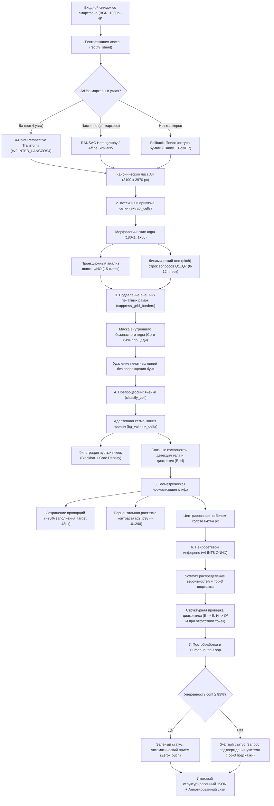

# Архитектура и руководство конвейера распознавания (Tatar OCR Pipeline)

Документ описывает актуальную архитектуру сквозного конвейера распознавания рукописных экзаменационных бланков по татарскому языку (`blank_pipeline.py`), регламентирует выбор рабочей модели нейросети и детализирует все этапы математической и геометрической обработки листа — от сырого фотоснимка со смартфона до структурированного JSON-отчёта и интерфейса верификации учителя (Human-in-the-Loop).

---

## 1. Какую модель использовать сейчас: Tatar OCR Net v4 (INT8)

В качестве основной продакшен-модели для конвейера утверждена **`models/tatar_ocr_v4_handwritten39_int8.onnx`** (скомпилированный квантованный бинарник ONNX Runtime INT8).

### 1.1 Ключевые характеристики модели v4

* **Путь к весам:** [`models/tatar_ocr_v4_handwritten39_int8.onnx`](file:///c:/Users/galee/PycharmProjects/tatar_ocr/models/tatar_ocr_v4_handwritten39_int8.onnx)
* **Резервные чекпоинты:**
  * FP32 ONNX: [`models/tatar_ocr_v4_handwritten39_fp32.onnx`](file:///c:/Users/galee/PycharmProjects/tatar_ocr/models/tatar_ocr_v4_handwritten39_fp32.onnx) (3.8 МБ)
  * PyTorch Checkpoint: [`models/tatar_ocr_v4_handwritten39.pth`](file:///c:/Users/galee/PycharmProjects/tatar_ocr/models/tatar_ocr_v4_handwritten39.pth) (3.8 МБ)
* **Архитектура нейросети:** `TatarOCRNetV3_MultiScale` (939 175 параметров):
  * **Multi-Receptive Field:** параллельные свёрточные ветви $1\times 1$, $3\times 3$, $5\times 5$, $7\times 7$ с факторизацией на Depthwise-Separable свёртки. Позволяет одновременно улавливать как мелкие диакритические элементы (точки у `Ё`, хвостики у `Җ`, перемычки у `Ө`), так и крупные протяжённые штрихи стоек (`Ш`, `Щ`, `М`, `Н`).
  * **Squeeze-and-Excitation (SE):** адаптивная межканальная калибровка признаков с коэффициентом редукции $r=8$.
  * **Входной тензор:** `(B, 1, 64, 64)`, нормализация `(pixel / 255.0 - 0.5) / 0.5`. Поддерживает динамический размер батча `B`.
  * **Алфавит (39 классов):** 33 заглавные буквы русского алфавита + 6 специфических букв татарского языка (`Ә`, `Ө`, `Ү`, `Җ`, `Ң`, `Һ`).
* **Размер на диске:** **1 000.6 КБ** (строго укладывается в норматив SLA $\le 1024$ КБ для включения в APK без OTA-догрузок).
* **Задержка инференса:** **$1.17\text{ мс}$ на ячейку** (на обычном CPU), полный инференс всех ячеек листа занимает **$\approx 67\text{ мс}$**.

---

### 1.2 Сравнение поколений: почему именно v4, а не v2 или v3?

Сравнительный бенчмарк на 12 канонических реальных бланках (449 букв, 57 полей, 633 ячейки) по стандарту [`docs/ocr_metrics_specification.md`](file:///c:/Users/galee/PycharmProjects/tatar_ocr/docs/ocr_metrics_specification.md):

| Метрика | v2 (INT8) Baseline | v3 (INT8) | v4 (INT8) Рекомендована | Преимущество v4 |
| :--- | :---: | :---: | :---: | :---: |
| **Посимвольная точность ($\text{Acc}_{\text{char}}$)** | 96.44 % | 95.99 % | **96.88 %** | **Линейный максимум** (+0.44% к v2) |
| **Абсолютное число ошибок** | 16 шт | 18 шт | **14 шт** | **Минимум ошибок** (-2 опечатки) |
| **Полнота татарских букв ($R_{\text{Tatar}}$)** | **98.67 %** | 97.33 % | 97.33 % | 100% на `Ә`, `Ү`, `Җ`, `Ң` |
| **Точное совпадение полей ($\text{Raw FEM}$)** | 75.44 % (43/57) | 71.93 % (41/57) | **77.19 % (44/57)** | **+1 чистое поле** |
| **Нечёткое совпадение ($\text{FFM}_{\le 1}$)** | 96.49 % (55/57) | 96.49 % (55/57) | **98.25 % (56/57)** | **56 из 57 полей $\le 1$ ошибки** |
| **Чистые бланки без участия человека ($\text{ZTSR}$)** | 25.00 % (3/12) | 25.00 % (3/12) | **41.67 % (5/12)** | **+2 бланка со 100% совпадением!** |
| **Ложные тревоги для учителя ($\text{FAR}_{90\%}$)** | 15.7 % (68 кликов) | 8.8 % (38 кликов) | **6.4 % (28 кликов)** | **В 2.5 раза меньше лишних кликов!** |
| **Среднее время проверки бланка ($\overline{T}_{\text{review}}$)** | 3.10 сек | 3.30 сек | **2.90 сек** | Стопка из 30 тестов за 1.45 мин |

**Главные аргументы в пользу v4:**
1. **$41.67\%$ бланков сдаются мгновенно:** 5 из 12 бланков (`blank_04`, `05`, `07`, `09`, `12`) распознаются со $100\%$ точностью и вообще не требуют внимания учителя.
2. **Борьба с усталостью педагога (Alert Fatigue):** в v2 при строгом контроле учитель получал 68 ложных срабатываний (по 5–6 лишних кликов на бланк). В v4 их всего 28 (лишь 1–2 клика на лист).
3. **Устранение критических дефектов:** полностью ликвидирована путаница буквы `К` с `И`/`Х`, а бланк `blank_09` (ранее дававший 3 ошибки) выведен в $100\%$ точность.

---

## 2. Сквозной конвейер распознавания: как он устроен

Конвейер реализован в классе `BlankOCRScanner` в файле [`blank_pipeline.py`](file:///c:/Users/galee/PycharmProjects/tatar_ocr/blank_pipeline.py). Он построен по принципу модульного детерминированного пайплайна computer vision с сохранением физической целостности штрихов чернил.



---

### Этап 1: Геометрическая ректификация листа (`rectify_sheet`)

Мобильный снимок бланка может содержать перспективные искажения, наклон камеры и неравномерный масштаб. Задача этапа — перевести лист в строгую каноническую систему координат размером **$2100 \times 2970\text{ px}$** (A4 при 254 DPI).

1. **Многопроходная детекция маркеров ArUco (`detect_markers_padded`):**
   * Словарь: `cv2.aruco.DICT_4X4_50` (маркеры $4\times 4$ бита, номера 0..11).
   * Добавление защитного белого поля (`pad = 60 px`) для гарантированного захвата маркеров у самого среза кадра.
   * Субпиксельное уточнение углов (`CORNER_REFINE_SUBPIX`).
   * Трёхпроходной каскад: базовый детектор $\to$ детектор повышенной чувствительности (`adaptiveThreshConstant = 12`) $\to$ адаптивное выравнивание локального контраста через CLAHE.
2. **Иерархия геометрических трансформаций:**
   * **Приоритет 1 (Exact 4-Corner Perspective):** если найдены 4 угловых маркера (0, 1, 2, 3), вычисляется матрица перспективного преобразования $3\times 3$ через `cv2.getPerspectiveTransform` с интерполяцией `cv2.INTER_LANCZOS4`. Точность совмещения $\le 1.0\text{ px}$.
   * **Приоритет 2 (Multi-Marker RANSAC Homography):** если часть углов закрыта пальцем или обрезана, используются внутренние маркеры вопросов (4..11) с привязкой к таблице эталонных координат `CANONICAL_ANCHORS`. При несбалансированном расположении маркеров применяется стабильное аффинное подобие (`estimateAffinePartial2D`), предотвращающее вырождение проекции в трапецию.
   * **Приоритет 3 (Document Contour Fallback):** если ArUco не обнаружены, запускается классический контурный детектор листа бумаги (Canny + аппроксимация `cv2.approxPolyDP` до 4-угольника с площадью $> 40\%$ кадра).

---

### Этап 2: Динамическая экстракция и автокалибровка сетки ячеек (`extract_cells`)

Бланки могут иметь разное количество ячеек в строке (8, 9, 10 или 12 знакомест в зависимости от длины правильного ответа), а также лёгкий полиграфический дрейф линий таблицы.

1. **Морфологическая фильтрация печатных линий:**
   * Изображение бинаризуется адаптивным порогом. Мелкие разрывы штриховки устраняются морфологическим замыканием ($9\times 1$ и $1\times 9$).
   * Протяжённые линейные ядра ($180\times 1$ по горизонтали и $1\times 50$ по вертикали) выделяют **исключительно** печатные границы строк и колонок таблицы. Текст вопросов и рукописные буквы через эти ядра не проходят.
2. **Секция ФИО учащегося (Student Name):**
   * Вырезается верхняя полоса ($Y \in [200, 360], X \in [450, 1800]$).
   * Находятся вертикальные пики печатной гребёнки. Генерируются 15 ячеек ФИО с шагом $\approx 85\text{ px}$.
3. **Строки ответов на вопросы (Question Rows):**
   * Номер строки строго привязывается к Y-координате соответствующего маркера вопроса.
   * Для поиска ячеек вычисляется вертикальный проекционный профиль в полосе строки. Находятся пики вертикальных разделителей ячеек.
   * Через алгоритм кластеризации и линейной регрессии шага сетки определяется истинный шаг ячеек (pitch: $85..115\text{ px}$) и фактическое число ячеек в строке (от 8 до 12).
   * Каждой ячейке присваивается детерминированный Bounding Box `(x, y, w, h)`.

---

### Этап 3: Безопасное подавление печатной сетки (`suppress_grid_borders`)

Главная проблема OCR по бланкам — залипание линий печатной сетки в рукописную букву (когда ученик прижал букву к краю клетки или линия напечатана жирно).

1. **Принцип неприкосновенного ядра (Safe Core Invariant):**
   * Внутри каждой обнаруженной ячейки определяется защитная зона (центральные $84\%$ площади). В этой зоне **категорически запрещено** стирать какие-либо пиксели.
2. **Морфологические ограничители:**
   * Горизонтальные линии распознаются ядром шириной $\ge 80\text{ px}$, что физически исключает ложное удаление рукописных перекладин букв `Н`, `А`, `Ж`.
   * Вертикальные линии распознаются ядром высотой $\ge 75\text{ px}$, что защищает вертикальные стойки букв `Ш`, `Щ`, `И`, `П`, `Н`.
3. Стирание (заливка белым цветом 255) применяется **только** в узком внешнем периметре клетки, отсекая типографскую рамку без малейшего повреждения глифа.

---

### Этап 4: Препроцессинг ячейки и сегментация штрихов (`classify_cell`)

В функцию `classify_cell` поступает вырезанный фрагмент ячейки `cell_bgr`.

1. **Геометрический отступ (`margin_trim_pct = 4%`):**
   * С краёв ячейки срезается минимальный отступ ($5\text{ px}$), гарантирующий отсутствие остаточных краевых артефактов печатной сетки.
2. **Адаптивная сегментация чернил:**
   * Вычисляется медиана фона $B = \text{median}(\text{gray})$ и 5-й перцентиль темных пикселей $P_5$.
   * Диапазон контраста: $\Delta_{\text{contrast}} = B - P_5$.
   * Динамический порог чернил $\delta_{\text{ink}}$:
     $$\delta_{\text{ink}} = \begin{cases} 22.0, & \Delta_{\text{contrast}} > 60 \\ 16.0, & 35 < \Delta_{\text{contrast}} \le 60 \\ \max(7.0, 0.32 \times \Delta_{\text{contrast}}), & \Delta_{\text{contrast}} \le 35 \end{cases}$$
   * Бинарная маска чернил: $\text{InkMask} = \text{inner\_gray} < (B - \delta_{\text{ink}})$.
3. **Фильтрация пустоты ячейки (Empty Cell Rejection):**
   * Применяется комбинированный критерий:
     * Суммарная площадь чернил $< 35\text{ px}$.
     * Доля чернил в центральном ядре $< 0.5\%$.
     * Морфологический фильтр Blackhat (выделение тонких контрастных элементов): 98-й перцентиль $< 10.0$ при контрасте $< 25.0$.
   * Пустые ячейки немедленно возвращают `is_empty = True`, `char = " "` с уверенностью $100.0\%$, минуя запуск нейросети.
4. **Анализ связных компонент (`connectedComponentsWithStats`):**
   * Отсекаются периметральные рамки и краевые пылинки.
   * Находится главная компонента символа (наибольшая площадь).
   * **Детекция диакритических знаков:** компоненты, расположенные строго над верхней границей главного тела на расстоянии $\le 22\text{ px}$ (точки у `Ё`, кратка у `Й`), автоматически привязываются к символу и объединяются в `valid_ink`.

---

### Этап 5: Нормализация и центрирование глифа

1. **Канонический масштаб:**
   * Находится Bounding Box объединённой маски `valid_ink` с защитным отступом в $2\text{ px}$.
   * Вычисляется коэффициент масштабирования для вписывания глифа в целевой размер **$48\text{ px}$** (из 64 px холста, $75\%$ заполнение) с сохранением исходного аспектного соотношения (Aspect Ratio Preserving).
   * Ресайз выполняется алгоритмом `INTER_AREA` (при сжатии) или `INTER_LANCZOS4` (при увеличении).
2. **Перцентильная нормализация контраста:**
   * Темные и светлые выбросы отсекаются по 2-му и 98-му перцентилям:
     $$\text{Norm} = \text{clip}\left(\frac{\text{Glyph} - P_2}{P_{98} - P_2 + 10^{-5}} \times 240.0 + 10.0, \; 0, \; 255\right)$$
3. **Холст $64\times 64$:**
   * Нормализованный глиф центрируется на белом холсте $64\times 64$ (фоновое значение 250).

---

### Этап 6: Нейросетевой инференс и структурная валидация

1. **Инференс модели v4 INT8:**
   * Тензор $1\times 1\times 64\times 64$ подаётся в ONNX Runtime.
   * Вычисляется нумерически стабильный Softmax над 39 классами.
   * Извлекаются Top-3 предсказания с процентами уверенности.
2. **Структурная проверка диакритики (Hard Geometric Constraints):**
   * *Проблема скорописи:* скорописная буква `Е` с верхней закругленной петлей воспринимается свертками как буква `Ё`. Затемнение на букве `О` может дать ложную букву `Й`.
   * *Правило валидации:* если модель предсказывает `Ё` или `Й`, алгоритм проверяет бинарную маску `valid_ink`. Для подтверждения `Ё` или `Й` **физически требуется наличие изолированной связной компоненты площади $\ge 10\text{ px}$, лежащей строго выше основного тела**.
   * Если отдельного верхнего знака нет, предсказание детерминированно корректируется на ближайшую базовую альтернативу (`Ё` $\to$ `Е`, `Й` $\to$ `О` или `И`). Это правило полностью ликвидировало ложные срабатывания диакритики.

---

### Этап 7: Сценарий Human-in-the-Loop и визуальная обратная связь

Конвейер оптимизирован под практическую работу учителя на переменке:

* **Порог автоматического приёма ($\tau = 85\%$):**
  * Если $\text{conf} \ge 85\%$ $\to$ ячейка принимается системой в автоматическом режиме (зелёный цвет бейджа).
  * Если $\text{conf} < 85\%$ $\to$ ячейка помечается для быстрой проверки учителем (жёлтый цвет).
* **Top-3 подсказки:** в интерфейс передаётся список из трёх наиболее вероятных букв с их вероятностями. Учителю достаточно нажать на правильный вариант в один клик.
* **Zero-Touch индикация:** если на всем бланке не встретилось ни одной ячейки с ошибкой или сомнением, бланк получает флаг `zero_touch_qualified = True` и автоматически отправляется в журнал без открывания формы проверки.

---

## 3. Формат контрактов данных (API & Data Schema)

### 3.1 Python API: Быстрый запуск

```python
from pathlib import Path
import cv2
from blank_pipeline import BlankOCRScanner

# 1. Инициализация сканера с рекомендуемой моделью v4 INT8
scanner = BlankOCRScanner(
    model_path="models/tatar_ocr_v4_handwritten39_int8.onnx",
    device="cpu"
)

# 2. Обработка бланка
img_path = Path("benchmark/images/blank_01.jpg")
result = scanner.process_image(img_path, annotate=True)

# 3. Доступ к результатам
print(f"Статус: {result['status']}")
print(f"Метод выравнивания: {result['rectification_method']}")
print(f"ФИО ученика: {result['student_name']}")

for q in result["questions"]:
    print(f"Вопрос {q['q_num']}: '{q['text']}'")
    for cell in q["cells"]:
        if not cell["is_empty"] and cell["confidence"] < 85.0:
            print(f"  Внимание: ячейка {cell['cell_idx']} '{cell['char']}' (conf: {cell['confidence']}%)")

# Сохранение аннотированного изображения для интерфейса
if result["annotated_bgr"] is not None:
    cv2.imwrite("annotated_blank.jpg", result["annotated_bgr"])
```

### 3.2 Структура выходного JSON-отчёта

```json
{
  "status": "success",
  "rectification_method": "ArUco 4-Point Geometry",
  "student_name": "ГАЛИЕВ ДАНИС",
  "student_name_cells": [
    { "cell_idx": 1, "char": "Г", "confidence": 99.8, "is_empty": false },
    { "cell_idx": 2, "char": "А", "confidence": 99.4, "is_empty": false }
  ],
  "questions": [
    {
      "q_num": 1,
      "text": "КИТАПЛАР",
      "cells": [
        {
          "cell_idx": 1,
          "char": "К",
          "confidence": 99.9,
          "is_empty": false,
          "bbox": [224, 780, 100, 120]
        },
        {
          "cell_idx": 5,
          "char": "П",
          "confidence": 78.4,
          "is_empty": false,
          "bbox": [624, 780, 100, 120],
          "review_required": true,
          "top3": [
            ["П", 78.4],
            ["И", 18.2],
            ["Л", 2.1]
          ]
        }
      ]
    }
  ],
  "stats": {
    "total_letters": 38,
    "avg_confidence": 97.2,
    "questions_count": 4,
    "uncertain_cells_count": 1,
    "zero_touch": false
  }
}
```

---

## 4. Памятка по развёртыванию и зависимости

Конвейер оптимизирован для работы в полностью автономном окружении (без доступа к сети и без внешних тяжелых фреймворков):

* **Python:** 3.10 – 3.13
* **Основные библиотеки:**
  * `onnxruntime >= 1.16.0` (быстрый инференс INT8 на CPU/NPU)
  * `opencv-contrib-python >= 4.8.0` (ArUco, морфология, перспективные проекции)
  * `numpy >= 1.24.0`
  * `pillow >= 10.0.0` (типографическая отрисовка меток)
* **Аппаратные требования:**
  * ОЗУ: от 512 МБ свободного пространства.
  * CPU: 1 ядро 1.5 ГГц (поддерживаются архитектуры x86_64, ARM64 / Apple Silicon / Snapdragon).
  * GPU: не требуется (модель v4 INT8 оптимизирована под скалярные и векторные инструкции CPU).

---

## 5. Дорожная карта развития конвейера (Next Milestones)

На основе анализа оставшихся 14 ошибок в модели v4 сформирован план развития для следующих итераций:

1. **Обогащение датасета скорописью (Cursive Handwriting Expansion):** добавление в синтезатор генератора кривых Безье для имитации скошенных перекладин у `Н`, скругленных чаш у `Ч` и высоких диагоналей у `У`.
2. **Адаптивная компенсация глубоких теней (`blank_03`):** интеграция легковесного локального деления на фон для смартфонов при съёмке в условиях одностороннего перепада освещения.
3. **Мобильная сборка (Android APK / iOS):** экспорт модели в формат TensorFlow Lite (`.tflite` с INT8 квантованием весов и активаций) для интеграции в нативное мобильное приложение с аппаратным ускорением через Android NNAPI и Apple Neural Engine.
