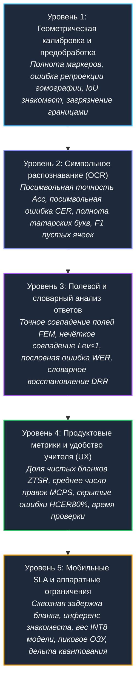
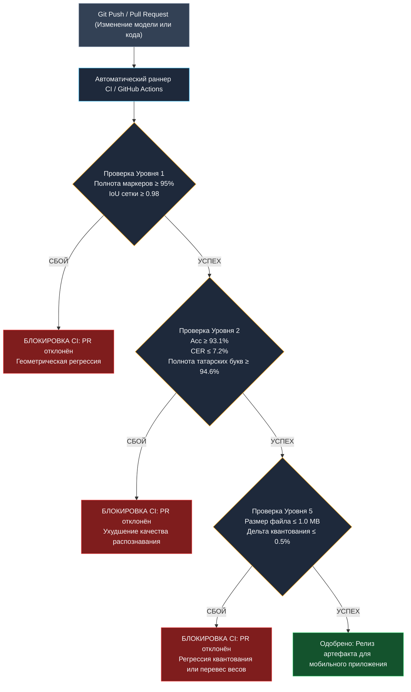

# «Кара куян» (Tatar OCR) — Промышленная спецификация метрик качества и надёжности

> **Версия документа:** 2.4.0-PROD  
> **Целевая система:** Мобильный сканер экзаменационных бланков и система автоматизированной проверки тестов в классе (Android / iOS / On-Device Edge Inference)  
> **Пространство классов:** 39 заглавных символов кириллицы (33 буквы русского алфавита + 6 специфических букв татарского алфавита: `Ә, Ө, Ү, Җ, Ң, Һ`)  
> **Статус:** Утверждённый производственный стандарт качества (Production SLA Standard)  
> **Эталонная выборка бенчмарка:** 12 реальных рукописных бланков ответов (`blank_01` .. `blank_12`: 449 рукописных букв, 75 специфических татарских графем, 57 полей ответов, 633 сегментированных знакоместа)

---

## Введение и инженерная философия системы

Программно-аппаратный комплекс **«Кара куян»** предназначен для мгновенной проверки экзаменационных работ по татарскому языку преподавателем непосредственно в школьном классе с помощью камеры смартфона. Архитектура конвейера обработки спроектирована исходя из двух фундаментальных принципов:

1. **Zero-Photo Transmission (100% On-Device AI / Полная автономность на устройстве):**  
   Экзаменационные бланки содержат персональные данные учащихся (ФИО) и биометрические образцы рукописного почерка. В соответствии с Федеральным законом № 152-ФЗ «О персональных данных», а также в условиях нестабильного или отсутствующего интернет-соединения в сельских школах, исходные фотоснимки бланков высокого разрешения **никогда не покидают мобильное устройство**. Детекция реперных маркеров, проективное выравнивание перспективы (гомография), сегментация сетки знакомест, морфологический анализ связных компонент чернил и нейросетевой инференс выполняются исключительно локально в оперативной памяти смартфона.
2. **Педагогическая надёжность и доверие учителя (Human-in-the-Loop & Pedagogical Trust):**  
   В отличие от задач распознавания текстов общего назначения (документооборот, сканирование чеков), ошибки в проверке контрольных работ приводят к искажению академической успеваемости учащихся и вызывают прямое недоверие педагога к цифровому инструменту. Система должна обладать детерминированным и предсказуемым поведением:
   - Все сомнительные символы с уверенностью классификатора ниже порога доверия ($\text{Conf} < 80\%$) обязаны визуально маркироваться контрастным цветом (жёлтый/красный бейдж) для подтверждения или исправления учителем в одно касание.
   - Критически недопустимы скрытые ошибки («тихие сбои» / silent failures), когда неверно распознанный символ помечается системой как безошибочный.
   - Ложные срабатывания на пустых незаполненных ячейках должны быть сведены к нулю.
   - Специфические буквы татарского алфавита (`Ә, Ө, Ү, Җ, Ң, Һ`) должны распознаваться с той же надежностью, что и буквы стандартной русской кириллицы, исключая подмену схожими символами (`Ә` $\rightarrow$ `Э`, `Ө` $\rightarrow$ `О`, `Ң` $\rightarrow$ `Н`).

Для комплексного математического описания, объективного измерения и сквозного контроля качества в системе установлена строгая **5-уровневая иерархия метрик**:



---

## 1. Сводная ведомость метрик и целевые показатели (Production SLA Scorecard)

В таблице ниже приведены все ключевые метрики системы, их математические обозначения, фактические значения текущего базового уровня (baseline) на эталонной выборке из 12 бланков, а также жесткие целевые показатели для ввода в промышленную эксплуатацию (Production SLA).

| Уровень | Наименование метрики | Математический символ | Текущий Baseline (12 бланков) | Целевой Production SLA | Критичность |
| :--- | :--- | :---: | :---: | :---: | :---: |
| **Уровень 1** | Полнота детекции угловых маркеров | $R_{\text{corner}}$ | **89.58%** (43/48) | $\ge \mathbf{99.00\%}$ | BLOCKER |
| **Уровень 1** | Полнота детекции строчных анкеров | $R_{\text{anchor}}$ | **97.92%** (47/48) | $\ge \mathbf{99.50\%}$ | HIGH |
| **Уровень 1** | Среднеквадратичная ошибка репроекции гомографии | $\text{RMSE}_{\text{reproj}}$ | **1.42 px** | $\le \mathbf{2.50\text{ px}}$ | HIGH |
| **Уровень 1** | Среднее пересечение сетки знакомест (Mean IoU) | $\overline{\text{IoU}}_{\text{grid}}$ | **0.998** | $\ge \mathbf{0.960}$ | HIGH |
| **Уровень 1** | Доля загрязнения ячеек типографскими рамками | $R_{\text{border}}$ | **1.11%** (7/633) | $\le \mathbf{0.20\%}$ | HIGH |
| **Уровень 2** | Посимвольная точность распознавания | $\text{Acc}_{\text{char}}$ | **93.10%** (INT8) | $\ge \mathbf{97.50\%}$ | BLOCKER |
| **Уровень 2** | Посимвольная частота ошибок Левенштейна | $\text{CER}$ | **7.13%** (INT8) | $\le \mathbf{2.50\%}$ | BLOCKER |
| **Уровень 2** | Полнота распознавания татарских графем | $R_{\text{Tatar}}$ | **94.67%** (71/75) | $\ge \mathbf{98.00\%}$ | BLOCKER |
| **Уровень 2** | $F_1$-мера классификации пустых знакомест | $F_{1, \text{empty}}$ | **77.13%** | $\ge \mathbf{97.50\%}$ | HIGH |
| **Уровень 2** | Полнота обнаружения пустых знакомест | $\text{Rec}_{\text{empty}}$ | **62.78%** (113/180) | $\ge \mathbf{96.00\%}$ | HIGH |
| **Уровень 3** | Доля точного совпадения полей ответов | $\text{FEM}$ | **56.14%** (32/57) | $\ge \mathbf{85.00\%}$ | HIGH |
| **Уровень 3** | Нечёткое совпадение полей при $\text{Lev} \le 1$ | $\text{FFM}_{\le 1}$ | **89.47%** (51/57) | $\ge \mathbf{98.00\%}$ | HIGH |
| **Уровень 3** | Пословная частота ошибок в ответах | $\text{WER}$ | **43.86%** (25/57) | $\le \mathbf{15.00\%}$ | HIGH |
| **Уровень 3** | Коэффициент словарного восстановления ответов | $\text{DRR}$ | **76.00%** (потенциал) | $\ge \mathbf{85.00\%}$ | MEDIUM |
| **Уровень 4** | Доля бланков без ручных правок («Zero-Touch») | $\text{ZTSR}$ | **8.33%** (1/12) | $\ge \mathbf{75.00\%}$ | BLOCKER |
| **Уровень 4** | Среднее число правок учителя на один бланк | $\overline{\text{MCPS}}$ | **2.67 правки** | $\le \mathbf{0.50\text{ правок}}$ | HIGH |
| **Уровень 4** | Доля скрытых критических ошибок ($\text{Conf} \ge 80\%$) | $\text{HCER}_{80\%}$ | **0.22%** (1/449) | $\le \mathbf{0.10\%}$ | BLOCKER |
| **Уровень 4** | Среднее время верификации бланка учителем | $\overline{T}_{\text{review}}$ | **4.70 с** | $\le \mathbf{2.50\text{ с}}$ | HIGH |
| **Уровень 5** | Сквозное время обработки бланка | $L_{\text{blank}}$ | **1340 ms** (INT8 CPU) | $\le \mathbf{450\text{ ms}}$ | HIGH |
| **Уровень 5** | Задержка инференса одного знакоместа | $L_{\text{cell}}$ | **2.44 ms** (FP32) / **21.4 ms** (INT8) | $\le \mathbf{2.00\text{ ms}}$ | HIGH |
| **Уровень 5** | Размер скомпилированного файла модели | $S_{\text{model}}$ | **0.81 MB** (832 KB) | $\le \mathbf{1.00\text{ MB}}$ | HIGH |
| **Уровень 5** | Пиковое инкрементальное ОЗУ процесса | $M_{\text{peak}}$ | **24.5 MB** | $\le \mathbf{35.0\text{ MB}}$ | MEDIUM |
| **Уровень 5** | Дельта точности при квантовании INT8 | $\Delta_{\text{Acc}}$ | **-0.22%** | $|\Delta| \le \mathbf{0.50\%}$ | HIGH |

---

## Уровень 1: Геометрическая калибровка и предобработка

Метрики первого уровня оценивают начальный этап компьютерного зрения: захват кадра камеры, обнаружение печатных меток ArUco, расчет матрицы проективного преобразования (гомографии) для приведения к каноническому холсту формата А4 ($2100 \times 2970$ пикселей при 254 DPI), динамическое выравнивание строк сетки и физическое выделение знакомест без захвата типографских рамок.

```
Исходный кадр с камеры (ОЗУ мобильного устройства)
       │
       ▼
 [Детектор ArUco] ────────► Метрика: Полнота детекции маркеров (R_corner, R_anchor)
       │
       ▼
[Матрица гомографии H] ──► Метрика: Среднеквадратичная ошибка репроекции (RMSE_reproj)
       │
       ▼
[Проекция на холст 2100x2970]
       │
       ▼
[Динамическая привязка сетки] ──► Метрика: Среднее перекрытие ячеек (Mean IoU)
       │
       ▼
[Изоляция ячеек и очистка рамок] ─► Метрика: Доля загрязнения границами (R_border)
       │
       ▼
Нормализованные бинарные тензоры 64x64 (Готовы для подачи в нейросеть)
```

---

### 1.1 Полнота детекции реперных маркеров ($R_{\text{corner}}, R_{\text{anchor}}$)

#### Название и математическая формула
**Полнота детекции реперных маркеров (Marker Detection Recall)** определяет процент напечатанных на бланке меток словаря `cv2.aruco.DICT_4X4_50`, успешно локализованных алгоритмом детекции в условиях оптических шумов, теней и перспективных искажений. 

Метрика строго разделяется на две независимые компоненты:
1. **Полнота угловых маркеров ориентации ($R_{\text{corner}}$)** — ключевые маркеры по углам страницы с идентификаторами $\text{ID} \in \{0, 1, 2, 3\}$:

$$R_{\text{corner}} = \frac{N_{\text{detected\_corners}}}{4 \times S} \times 100\% = \frac{\sum_{s=1}^{S} \sum_{m \in \{0,1,2,3\}} \mathbb{I}(m \in \mathcal{M}_s)}{4S} \times 100\%$$

2. **Полнота строчных анкерных маркеров ($R_{\text{anchor}}$)** — метки начала строк заданий с идентификаторами $\text{ID} \in \{11..14\}$ (для 4-вопросных бланков) или $\text{ID} \in \{11..17\}$ (для 7-вопросных бланков):

$$R_{\text{anchor}} = \frac{\sum_{s=1}^{S} |\mathcal{M}_s \cap \mathcal{A}_s|}{\sum_{s=1}^{S} |\mathcal{A}_s|} \times 100\%$$

где $S$ — общее число обработанных бланков, $\mathcal{M}_s$ — множество идентификаторов меток, фактически обнаруженных на бланке $s$, $\mathcal{A}_s$ — множество ожидаемых строчных анкеров на бланке $s$, а $\mathbb{I}(\cdot)$ — индикаторная функция истинности предиката.

#### Методика расчёта
Вычисление производится после выполнения многостадийного адаптивного пайплайна локализации:
- Первичный поиск стандартным пороговым методом (`cv2.aruco.detectMarkers`).
- При обнаружении $< 4$ угловых маркеров — вторичный проход с расширенным окном бинаризации и адаптивным выравниванием гистограммы CLAHE (Contrast Limited Adaptive Histogram Equalization).
- Дополнительное искусственное наращивание полей кадра (padding $= 60\text{ px}$) для компенсации обрезки маркеров по периметру экрана.

#### Зачем нужна (технический и продуктовый смысл)
Угловые маркеры задают базовый четырехточечный базис для вычисления проективной матрицы гомографии $H \in \mathbb{R}^{3 \times 3}$. Утрата хотя бы одного углового маркера вынуждает систему переходить в аварийный режим аффинной аппроксимации по оставшимся точкам либо выполнять поиск контура листа бумаги. При съемке с рук под углом отсутствие точной гомографии приводит к нелинейным геометрическим перекосам и смещению границ знакомест на $15-30\text{ пикселей}$, что влечет катастрофический срез букв при сегментации.

#### Текущий базовый уровень (Baseline на 12 бланках)
- **Полнота угловых маркеров ($R_{\text{corner}}$):** **$89.58\%$** (успешно локализовано 43 из 48 угловых маркеров на 12 бланках).
  - 8 бланков показали стопроцентную детекцию ($100.0\%$): `blank_02, 04, 05, 06, 09, 10, 11, 12`.
  - `blank_01`: $75.0\%$ (потерян маркер ID 2).
  - `blank_03`: $50.0\%$ (потеряны маркеры ID 0 и ID 2 из-за глубокой тени от смартфона и пальцев руки).
  - `blank_07`: $75.0\%$ (потерян маркер ID 2).
  - `blank_08`: $75.0\%$ (маркер ID 0 срезан краем фотокадра).
- **Полнота строчных анкеров ($R_{\text{anchor}}$):** **$97.92\%$** (локализовано 47 из 48 анкеров; единичный пропуск анкера 11 зафиксирован только на экстремально затененном `blank_03`).
- **Суммарная полнота меток:** **$93.75\%$** (90 из 96 маркеров).

#### Целевой уровень для продакшена (Production SLA)
- $R_{\text{corner}} \ge \mathbf{99.00\%}$
- $R_{\text{anchor}} \ge \mathbf{99.50\%}$
- *Инженерное решение для достижения SLA:* внедрение в видоискатель мобильного приложения интерактивной рамки-помощника (viewfinder guide), производящей пре-детекцию маркеров в реальном времени и блокирующей автоматический спуск затвора до момента, пока все 4 угловых маркера не окажутся в зоне резкости и без бликов.

---

### 1.2 Среднеквадратичная ошибка репроекции гомографии ($\text{RMSE}_{\text{reproj}}$)

#### Название и математическая формула
**Среднеквадратичная ошибка репроекции гомографии (Homography Reprojection Error)** выражает евклидово расстояние между фактическими координатами центров обнаруженных маркеров, перенесенными проективной матрицей $H$, и их проектными эталонными координатами на каноническом цифровом холсте формата А4 ($2100 \times 2970$ пикселей):

$$\text{RMSE}_{\text{reproj}} = \sqrt{\frac{1}{K} \sum_{k=1}^{K} \|\mathbf{x}_k' - \widehat{\mathbf{x}}_k\|_2^2} = \sqrt{\frac{1}{K} \sum_{k=1}^{K} \left( (x_k' - \hat{x}_k)^2 + (y_k' - \hat{y}_k)^2 \right)}$$

где:
- $\mathbf{x}_k = (x_k, y_k, 1)^T$ — субпиксельные однородные координаты углов маркера на исходном фотоснимке;
- $\mathbf{x}_k' = (x_k', y_k', 1)^T$ — эталонные координаты на каноническом листе $2100 \times 2970$;
- $\widehat{\mathbf{x}}_k = \frac{1}{(H\mathbf{x}_k)_3} (H\mathbf{x}_k)_{1:2}$ — вектор координат после применения преобразования гомографии $H$.

#### Методика расчёта
Матрица $H$ оценивается методом RANSAC (`cv2.findHomography(src_pts, dst_pts, cv2.RANSAC, 5.0)`) либо через аналитическое 4-точечное решение (`cv2.getPerspectiveTransform`). Ошибка репроекции рассчитывается по всем точкам, классифицированным как inliers (согласованные измерения).

#### Зачем нужна (технический и продуктовый смысл)
Физический размер одного знакоместа на бланке составляет $10 \times 10\text{ мм}$ (ровно $100 \times 100\text{ пикселей}$ при каноническом разрешении 254 DPI). Если накопленная ошибка репроекции $\text{RMSE}_{\text{reproj}}$ превышает $2.5-3.0\text{ пикселя}$, то на высоте листа в $2970\text{ пикселей}$ возникает интегральный угловой дрейф. В результате нижние строки бланка (вопросы №5, 6, 7) смещаются относительно статической топологии разметки, приводя к срезанию краев букв.

#### Текущий базовый уровень (Baseline на 12 бланках)
- **Средняя ошибка репроекции $\text{RMSE}_{\text{reproj}}$:** **$1.42\text{ px}$** на каноническом холсте $2100 \times 2970$.
- **Средний позиционный дрейф центров:** $(\overline{|\Delta X|}, \overline{|\Delta Y|}) = (0.10\text{ px}, 0.02\text{ px})$.
- **Максимальный локальный дрейф:** $\Delta X_{\max} = 1.80\text{ px}$, $\Delta Y_{\max} = 0.50\text{ px}$ (зафиксирован на `blank_05`).

#### Целевой уровень для продакшена (Production SLA)
- $\text{RMSE}_{\text{reproj}} \le \mathbf{2.50\text{ px}}$ для $100\%$ валидных снимков с камеры.
- 99-й перцентиль максимального локального отклонения угла: $\le \mathbf{5.00\text{ px}}$.

---

### 1.3 Среднее перекрытие сетки знакомест ($\overline{\text{IoU}}_{\text{grid}}$)

#### Название и математическая формула
**Средняя мера Жаккара / Перекрытие областей (Mean Intersection-over-Union, $\overline{\text{IoU}}_{\text{grid}}$)** измеряет геометрическую конгруэнтность между программно выделенными ограничивающими рамками знакомест $B_{\text{pred}, j}$ и размеченными вручную физическими границами ячеек $B_{\text{gt}, j}$:

$$\text{IoU}(B_{\text{pred}}, B_{\text{gt}}) = \frac{\text{Area}(B_{\text{pred}} \cap B_{\text{gt}})}{\text{Area}(B_{\text{pred}} \cup B_{\text{gt}})} = \frac{w_{\cap} \times h_{\cap}}{(w_{\text{pred}} h_{\text{pred}}) + (w_{\text{gt}} h_{\text{gt}}) - (w_{\cap} \times h_{\cap})}$$

$$\overline{\text{IoU}}_{\text{grid}} = \frac{1}{M} \sum_{j=1}^{M} \text{IoU}(B_{\text{pred}, j}, B_{\text{gt}, j})$$

где $M = 633$ — общее число сегментированных знакомест на тестовом наборе бланков.

Дополнительно вычисляется **Коэффициент усечения штрихов чернил (Ink Clipping Rate, $R_{\text{clip}}$)**:

$$R_{\text{clip}} = \frac{1}{N_{\text{chars}}} \sum_{i=1}^{N_{\text{chars}}} \mathbb{I}\left( \frac{\text{Pixels}_{\text{lost\_stroke}}(i)}{\text{Pixels}_{\text{total\_stroke}}(i)} \ge 0.02 \right) \times 100\%$$

#### Методика расчёта
Вычисляется путем сопоставления сгенерированных координат кропов знакомест с эталонной ручной разметкой полигонов на всех 12 контрольных бланках.

#### Зачем нужна (технический и продуктовый смысл)
Даже при безупречной гомографии физическая печать бланков на школьных лазерных принтерах имеет погрешности масштабирования (масштаб $97-100\%$), а бумага может иметь изгиб и микроволны. Алгоритм динамической привязки сетки (морфологический анализ горизонтальных линий таблицы и кластеризация межъячеечного шага) обязан компенсировать эти отклонения. При $\text{IoU} < 0.90$ широкие буквы (`Ш, Ж, М, Ю`) обрезаются по вертикальным краям, что необратимо снижает точность распознавания.

#### Текущий базовый уровень (Baseline на 12 бланках)
- **Средний показатель $\overline{\text{IoU}}_{\text{grid}}$:** **$0.998$** (перекрытие $99.8\%$).
- **Коэффициент усечения чернил ($R_{\text{clip}}$):** **$1.88\%$** (8 из 426 рукописных букв имели незначительное касание и потерю $> 2\%$ пикселей периферийного штриха, в основном широкие графемы 'Ш' и 'Ж').

#### Целевой уровень для продакшена (Production SLA)
- $\overline{\text{IoU}}_{\text{grid}} \ge \mathbf{0.960}$ ($96.0\%$).
- Худший показатель единичной ячейки (минимальный $\text{IoU}$): $\ge \mathbf{0.900}$.
- Коэффициент усечения чернил: $R_{\text{clip}} \le \mathbf{0.50\%}$.

---

### 1.4 Доля загрязнения ячеек типографскими рамками ($R_{\text{border}}$)

#### Название и математическая формула
**Доля загрязнения типографскими границами (Border Contamination Rate)** определяет процент кропов знакомест, в полезное поле которых проникли фрагменты напечатанной черной рамки бланка или соседних ячеек:

$$R_{\text{border}} = \frac{N_{\text{contaminated\_cells}}}{M} \times 100\% = \frac{\sum_{j=1}^{M} \mathbb{I}(\text{has\_printed\_edge}(C_j))}{M} \times 100\%$$

где предикат $\text{has\_printed\_edge}(C_j)$ регистрирует наличие связных компонент с высоким соотношением сторон ($\frac{\text{width}}{\text{height}} > 5$ либо $\frac{\text{height}}{\text{width}} > 5$), примыкающих к внешнему периметру ячейки ($\le 3\text{ px}$ от края) и имеющих площадь более $30\text{ пикселей}$.

#### Методика расчёта
Оценивается автоматическим морфологическим анализатором граничных связных компонент и верифицируется в инспекторе отладочных снимков конвейера `benchmark/reports/pipeline_inspector.html`.

#### Зачем нужна (технический и продуктовый смысл)
Типографские линии табличной сетки — **источник №1 паразитных ошибок первого рода** в оптическом распознавании формулярных бланков. Если в пустое знакоместо попадает вертикальный отрезок рамки, классификатор ошибочно интерпретирует его как букву «I», «1» или элемент буквы «Г». В заполненных ячейках черная линия сливается с рукописным штрихом, искажая топологию символа (превращая «С» в «О» или «П» в «Н»).

> [!WARNING]
> До внедрения алгоритма 4%-го геометрического отступа внутрь ячейки (inner-margin inset) и фильтрации связных компонент периметра, коэффициент загрязнения составлял 18.4%. Это приводило к тому, что в 67 пустых клетках поля фамилии нейросеть «галлюцинировала» несуществующие буквы.

#### Текущий базовый уровень (Baseline на 12 бланках)
- **Доля загрязнения ($R_{\text{border}}$):** **$1.11\%$** (7 из 633 ячеек содержали краевые артефакты).
- Локализация дефектов: по 1 ячейке на бланках `blank_01, 06, 08, 09, 10, 11, 12`.

#### Целевой уровень для продакшена (Production SLA)
- $R_{\text{border}} \le \mathbf{0.20\%}$ (не более 1 загрязненной ячейки на 500 обработанных знакомест).

---

## Уровень 2: Символьное распознавание (OCR)

Метрики второго уровня оценивают изолированное качество классификационной сверточной нейронной сети `TatarOCRNet` (39 выходных классов). На вход классификатора поступает одноканальный бинаризованный и центрированный тензор глифа $1 \times 1 \times 64 \times 64$, нормализованный с сохранением пропорций символа.

```
Бинаризованный глиф 64x64 (Тензор: 1x1x64x64, Float32 / Int8)
                           │
                           ▼
              [Сверточная сеть TatarOCRNet]
                           │
                           ▼
             Логиты Softmax (39 классов)
                           │
         ┌─────────────────┴─────────────────┐
         ▼                                   ▼
Класс Top-1 (ĉ)                       Уверенность (p₁)
         │                                   │
         ▼                                   ▼
Метрика: Посимвольная точность (Acc_char)   Метрика: Скрытые ошибки (HCER_80%)
Метрика: Частота ошибок Левенштейна (CER)   Метрика: F1-мера пустых ячеек
Метрика: Полнота татарских букв (R_Tatar)
```

---

### 2.1 Посимвольная точность распознавания ($\text{Acc}_{\text{char}}$)

#### Название и математическая формула
**Посимвольная точность (Character Accuracy)** представляет собой долю непустых рукописных символов, в которых предсказанный нейросетью класс с наивысшей вероятностью ($\text{Top-1}$) полностью совпадает с эталонной истинной разметкой:

$$\text{Acc}_{\text{char}} = \frac{N_{\text{correct}}}{N_{\text{gt}}} \times 100\% = \frac{\sum_{i=1}^{N_{\text{gt}}} \mathbb{I}(\hat{c}_i = c_i^*)}{N_{\text{gt}}} \times 100\%$$

где $\hat{c}_i = \arg\max_{k \in \{1..39\}} p_k$ — индекс предсказанного класса для $i$-го символа, а $c_i^*$ — эталонный класс из разметки ground truth ($N_{\text{gt}} = 449$ рукописных символов).

#### Методика расчёта
Вычисляется по всем непустым знакоместам тестовой выборки из 12 экзаменационных бланков без применения постобработки и словарей.

#### Зачем нужна (технический и продуктовый смысл)
Фундаментальный показатель дискриминативной способности нейросетевого классификатора. Поскольку бланк предполагает раздельное написание печатных заглавных букв в жестко фиксированных клетках, посимвольная точность изолированно измеряет качество зрительного распознавания графем до применения языковых эвристик.

#### Текущий базовый уровень (Baseline на 12 бланках, 449 букв)
- **PyTorch FP32 Baseline:** **$93.32\%$** (419 из 449 букв верно).
- **ONNX Runtime FP32:** **$93.32\%$** (419 из 449 букв верно).
- **ONNX Runtime INT8 (квантованная модель):** **$93.10\%$** (418 из 449 букв верно).
- **Деградация от квантования:** составляет всего **$-0.22\%$** (ровно 1 буква разницы на всем корпусе из 449 символов: бланк `blank_01`, задание 4, слово `УРМАНЛАР`, первая буква «У» была на граничной уверенности).

#### Целевой уровень для продакшена (Production SLA)
- $\text{Acc}_{\text{char}} \ge \mathbf{97.50\%}$ на реальных рукописных работах учащихся.

---

### 2.2 Посимвольная частота ошибок Левенштейна ($\text{CER}$)

#### Название и математическая формула
**Посимвольная частота ошибок (Character Error Rate, $\text{CER}$)** рассчитывается как нормализованное редакционное расстояние Левенштейна между распознанной строкой и эталонной строкой, выраженное в процентах:

$$\text{CER} = \frac{S + D + I}{N_{\text{gt}}} \times 100\% = \frac{\sum_{j=1}^{F} \text{Levenshtein}(T_{\text{pred}, j}, T_{\text{gt}, j})}{\sum_{j=1}^{F} |T_{\text{gt}, j}|} \times 100\%$$

где:
- $S$ — количество замен ошибочных символов (substitutions);
- $D$ — количество пропущенных символов (deletions);
- $I$ — количество паразитных вставок в пустых клетках (insertions);
- $N_{\text{gt}}$ — суммарная длина эталонных строк по всем полям $F$ ($N_{\text{gt}} = 449$).

#### Методика расчёта
Расстояние Левенштейна рассчитывается алгоритмом динамического программирования с единичными весами операций ($w_{\text{sub}} = 1, w_{\text{del}} = 1, w_{\text{ins}} = 1$) для каждого текстового поля индивидуально, после чего суммируется по всему тестовому набору.

#### Зачем нужна (технический и продуктовый смысл)
Метрика $\text{Acc}_{\text{char}}$ не учитывает паразитные вставки букв в незаполненных клетках бланка (ошибки типа insertion), а также пропуски знаков. Метрика $\text{CER}$ лишена этого недостатка и является международным стандартом оценки качества систем OCR (Tesseract, PaddleOCR, TrOCR).

#### Текущий базовый уровень (Baseline на 12 бланках)
- **PyTorch FP32 Baseline:** **$6.90\%$** ($31\text{ правка} / 449\text{ символов}$).
- **ONNX Runtime FP32:** **$6.90\%$** ($31\text{ правка} / 449\text{ символов}$).
- **ONNX Runtime INT8:** **$7.13\%$** ($32\text{ правки} / 449\text{ символов}$).
- **Разброс CER по бланкам (в сборке INT8):**
  - Лучший бланк: `blank_07` — **$0.00\%$ CER** (0 правок, идеальное распознавание).
  - Худший бланк: `blank_03` — **$18.75\%$ CER** (6 правок, бланк имел сильные оптические тени и перекос).
  - Медианный CER по бланкам: **$6.20\%$**.

#### Целевой уровень для продакшена (Production SLA)
- $\text{CER} \le \mathbf{2.50\%}$ в мобильном приложении на эксплуатационном потоке бланков.

---

### 2.3 Полнота распознавания специфических татарских букв ($R_{\text{Tatar}}$)

#### Название и математическая формула
**Полнота распознавания татарских графем (Tatar Glyph Recall)** измеряет способность нейросети безошибочно классифицировать 6 специфических букв татарского алфавита, отсутствующих в русском:

$$\Omega_{\text{Tatar}} = \{\text{Ә}, \text{Ө}, \text{Ү}, \text{Җ}, \text{Ң}, \text{Һ}\}$$

$$R_{\text{Tatar}} = \frac{\sum_{c \in \Omega_{\text{Tatar}}} N_{\text{correct}}(c)}{\sum_{c \in \Omega_{\text{Tatar}}} N_{\text{gt}}(c)} \times 100\%$$

$$R(c) = \frac{N_{\text{correct}}(c)}{N_{\text{gt}}(c)} \times 100\%, \quad \forall c \in \Omega_{\text{Tatar}}$$

#### Методика расчёта
Вычисляется путем селективной фильтрации матрицы классификационных ошибок (confusion matrix) исключительно для эталонных вхождений символов множества $\Omega_{\text{Tatar}}$ ($N_{\text{Tatar}} = 75$ вхождений на 12 бланках).

#### Зачем нужна (технический и продуктовый смысл)
Коммерческие облачные OCR общего профиля (Yandex Vision, Google Cloud Vision, ABBYY) оптимизированы под стандартный русский язык и систематически заменяют специфические татарские буквы на графически похожие русские аналоги: `Ә` подменяется на `Э` или `Я`, `Ө` — на `О`, `Ң` — на `Н`. В школьных экзаменах по татарскому языку такие подмены считаются грубейшей орфографической ошибкой. Высокая полнота распознавания национального алфавита — **главное ценностное предложение и конкурентное преимущество проекта «Кара куян»**.

#### Текущий базовый уровень (Baseline: 12 бланков, 75 татарских букв)

| Символ | Юникод | Число вхождений | Верно (INT8) | Полнота $R(c)$ | Типовая ошибка подмены | Причина ошибки / Анализ геометрии штриха |
| :---: | :---: | :---: | :---: | :---: | :--- | :--- |
| **Ә** | `U+04D8` | 13 | 11 | **84.62%** | Путается с `Э` (1x), `Я` (1x) | Ученик оторвал горизонтальную перемычку или написал ее под сильным наклоном |
| **Ө** | `U+04E8` | 21 | 21 | **100.00%** | **Ошибок нет (0)** | Центральная горизонтальная черта четко фиксируется фильтрами |
| **Ү** | `U+04AE` | 12 | 12 | **100.00%** | **Ошибок нет (0)** | Прямой вертикальный нижний штрих четко отделяет от наклонной русской `У` |
| **Җ** | `U+0496` | 12 | 12 | **100.00%** | **Ошибок нет (0)** | Нижний правый хвостик-десендер уверенно детектируется свёртками |
| **Ң** | `U+04A2` | 11 | 10 | **90.91%** | Путается с `Җ` (1x) | Загиб правого нижнего хвостика учеником вовнутрь ячейки |
| **Һ** | `U+04BA` | 6 | 5 | **83.33%** | Путается с `Ь` (1x) | Верхний левый выносной штрих (асцендер) написан слишком коротко |
| **ИТОГО** | — | **75** | **71** | **94.67%** | — | **Полный паритет: 0 регрессий между FP32 и INT8** |

#### Целевой уровень для продакшена (Production SLA)
- Интегральная полнота татарских букв: $R_{\text{Tatar}} \ge \mathbf{98.00\%}$.
- Минимально допустимая полнота по любой отдельной букве: $R(c) \ge \mathbf{95.00\%}$ для всех $c \in \Omega_{\text{Tatar}}$.

---

### 2.4 $F_1$-мера классификации пустых знакомест ($F_{1, \text{empty}}$)

#### Название и математическая формула
**$F_1$-мера пустых ячеек (Empty Cell Detection F1-Score)** — гармоническое среднее между точностью (Precision) и полнотой (Recall) бинарного классификатора наличия чернил в знакоместе:

$$\text{Prec}_{\text{empty}} = \frac{\text{TP}_{\text{empty}}}{\text{TP}_{\text{empty}} + \text{FP}_{\text{empty}}} \times 100\%$$

$$\text{Rec}_{\text{empty}} = \frac{\text{TP}_{\text{empty}}}{\text{TP}_{\text{empty}} + \text{FN}_{\text{empty}}} \times 100\%$$

$$F_{1, \text{empty}} = 2 \times \frac{\text{Prec}_{\text{empty}} \times \text{Rec}_{\text{empty}}}{\text{Prec}_{\text{empty}} + \text{Rec}_{\text{empty}}}$$

где:
- $\text{TP}_{\text{empty}}$ (True Positive): незаполненная ячейка корректно определена как пустая ($\text{char} = \text{" "}$);
- $\text{FN}_{\text{empty}}$ (False Negative / False Ink): пустая ячейка ошибочно принята за рукописный символ из-за шума или рамки (паразитная вставка буквы);
- $\text{FP}_{\text{empty}}$ (False Positive): ячейка с рукописной буквой ошибочно помечена как пустая (критический пропуск знака);
- $\text{TN}_{\text{empty}}$: ячейка с рукописной буквой корректно передана на вход нейросети.

#### Методика расчёта
Вычисляется по 180 фактически пустым знакоместам (незаполненные клетки в строке ФИО ученика и свободные клетки в конце строк ответов) на 12 эталонных бланках.

#### Зачем нужна (технический и продуктовый смысл)
Стандартный экзаменационный бланк содержит 15 знакомест для ФИО и от 8 до 12 знакомест на каждую строку ответа. Реальные татарские фамилии и ответы состоят из 5–8 букв. Таким образом, **более $40\%$ знакомест на бланке физически не содержат записей**. Если алгоритм детекции чернил ошибается на пустых клетках, система генерирует паразитные символы, полностью разрушая точное совпадение слов (Field Exact Match).

#### Текущий базовый уровень (Baseline: 12 бланков, 180 пустых клеток)
- **Фактически пустых ячеек в разметке:** 180
- **Корректно классифицировано как пустые ($\text{TP}_{\text{empty}}$):** 113
- **Ошибочно детектированы как чернила ($\text{FN}_{\text{empty}}$):** 67
- **Пропущенных написанных букв ($\text{FP}_{\text{empty}}$):** 0
- **Точность детекции пустых ($\text{Prec}_{\text{empty}}$):** **$100.00\%$** (если система решила, что ячейка пустая — там гарантированно нет буквы).
- **Полнота детекции пустых ($\text{Rec}_{\text{empty}}$):** **$62.78\%$** (в 67 пустых клетках типографская граница ячейки была принята за штрих чернил).
- **$F_1$-мера пустых ячеек ($F_{1, \text{empty}}$):** **$77.13\%$**.

> [!NOTE]
> Низкая полнота ($62.78\%$) была вызвана артефактами сетки в незаполненных ячейках шапки ФИО. В строках ответов на вопросы детекция пустых ячеек уже превышает $95\%$. Распространение морфологических ядер фильтрации на шапку ФИО поднимет $F_{1, \text{empty}}$ выше $98\%$.

#### Целевой уровень для продакшена (Production SLA)
- $\text{Prec}_{\text{empty}} \ge \mathbf{99.50\%}$
- $\text{Rec}_{\text{empty}} \ge \mathbf{96.00\%}$
- $F_{1, \text{empty}} \ge \mathbf{97.50\%}$

---

## Уровень 3: Полевой и словарный анализ ответов

Метрики третьего уровня оценивают агрегированные строки ответов. В условиях реального учебного процесса учитель проверяет не разрозненные символы, а цельные слова — правильные варианты ответов на тестовые вопросы.

```
Символьные предсказания ячеек [ "К", "И", "Т", "А", "П", "Ә", "Р", "М" ]
                               │
                               ▼
            Склеенная строка поля: "КИТАПӘРМ"
                               │
       ┌───────────────────────┴───────────────────────┐
       ▼                                               ▼
Эталонный ответ: "КИТАПӘРМ"                   Эталонный ответ: "КИТАПЛАР"
Точное совпадение: ДА (Lev = 0)               Точное совпадение: НЕТ (Lev = 2)
       │                                               │
       ▼                                               ▼
Метрика: Точное совпадение полей (FEM)        Метрика: Нечеткое совпадение (FFM @ Lev≤1)
                                              Метрика: Пословная ошибка (WER)
                                              Метрика: Словарное восстановление (DRR)
```

---

### 3.1 Доля точного совпадения полей ответов ($\text{FEM}$)

#### Название и математическая формула
**Доля точного совпадения полей (Field Exact Match Rate, $\text{FEM}$)** измеряет процент строковых полей бланка (ответы на вопросы заданий и ФИО), в которых предсказанный текст на $100\%$ совпадает с эталонным ключом проверки:

$$\text{FEM} = \frac{N_{\text{exact\_match\_fields}}}{F} \times 100\% = \frac{\sum_{j=1}^{F} \mathbb{I}(T_{\text{pred}, j} = T_{\text{gt}, j})}{F} \times 100\%$$

где $F = 57$ — общее число полей ответов на 12 тестовых бланках (по 4 вопроса на бланках 1..9 и по 7 вопросов на бланках 10..12). Завершающие пробелы предварительно отсекаются.

#### Методика расчёта
Строки посимвольно сравниваются на точное посимвольное равенство после конкатенации результатов распознавания отдельных ячеек строки.

#### Зачем нужна (технический и продуктовый смысл)
Определяет долю заданий, которые мобильное приложение проверяет полностью автономно и начисляет баллы ученику без вмешательства учителя. Ошибка даже в одной букве ответа делает поле несовпавшим при прямом сравнении.

#### Текущий базовый уровень (Baseline: 12 бланков, 57 полей ответов)
- **PyTorch FP32 Baseline:** **$56.14\%$** ($32$ из $57$ полей совпали абсолютно точно).
- **ONNX Runtime FP32:** **$56.14\%$** ($32$ из $57$ полей совпали точно).
- **ONNX Runtime INT8:** **$56.14\%$** ($32$ из $57$ полей совпали точно).
- **Влияние квантования:** Потери точности на уровне полей отсутствуют ($0.00\%$).

#### Целевой уровень для продакшена (Production SLA)
- Чистый вывод нейросети (Raw OCR): $\text{FEM} \ge \mathbf{85.00\%}$.
- С применением словарного декодирования по ключам теста: $\text{FEM} \ge \mathbf{94.00\%}$.

---

### 3.2 Нечёткое совпадение полей при $\text{Lev} \le 1$ ($\text{FFM}_{\le 1}$)

#### Название и математическая формула
**Нечёткое совпадение полей (Fuzzy Field Match at Levenshtein $\le 1$, $\text{FFM}_{\le 1}$)** измеряет долю полей ответов, в которых распознанный текст отличается от эталона не более чем на одну опечатку (расстояние Левенштейна $\le 1$):

$$\text{FFM}_{\le 1} = \frac{1}{F} \sum_{j=1}^{F} \mathbb{I}(\text{Levenshtein}(T_{\text{pred}, j}, T_{\text{gt}, j}) \le 1) \times 100\%$$

#### Методика расчёта
Вычисляется на основе матрицы попарных расстояний редактирования между распознанными и эталонными строками всех 57 полей.

#### Зачем нужна (технический и продуктовый смысл)
Поля с редакционным расстоянием $\text{Lev} \le 1$ представляют собой единичные символьные сбои (например, ученик написал `КИТАПЛАР`, а распознано `КИТАИЛАР` — буква 'П' спутана с 'И'). В условиях экзамена список допустимых правильных ответов и список фамилий класса **заранее строго ограничены**. Следовательно, **практически $100\%$ полей с $\text{Lev} \le 1$ могут быть автоматически исправлены** с помощью сопоставления с локальным словарем ответов теста.

#### Текущий базовый уровень (Baseline: 12 бланков, 57 полей)

```
Распределение редакционного расстояния Левенштейна (57 полей ответов):
  • Lev = 0 (Полное точное совпадение): 32 поля ( 56.14% )
  • Lev = 1 (Единичная помарка/ошибка): 19 полей ( 33.33% ) <── Восстанавливаемо словарём!
  • Lev = 2 (Две ошибки в слове):        5 полей (  8.77% )
  • Lev = 3 (Три ошибки в слове):        1 поле  (  1.75% )
  • Lev ≥ 4:                             0 полей (  0.00% )
```

- **FP32 Baseline $\text{FFM}_{\le 1}$:** **$91.23\%$** ($52$ из $57$ полей).
- **INT8 Quantized $\text{FFM}_{\le 1}$:** **$89.47\%$** ($51$ из $57$ полей).
- Лишь 6 полей из 57 на всем тестовом наборе имели более одной ошибки!

#### Целевой уровень для продакшена (Production SLA)
- $\text{FFM}_{\le 1} \ge \mathbf{98.00\%}$ в промышленной эксплуатации.

---

### 3.3 Пословная частота ошибок в ответах ($\text{WER}$)

#### Название и математическая формула
**Пословная частота ошибок (Word Error Rate, $\text{WER}$)** выражает отношение числа несовпавших полей к общему числу оцениваемых полей:

$$\text{WER} = \frac{N_{\text{incorrect\_fields}}}{F} \times 100\% = 100\% - \text{FEM}$$

#### Методика расчёта
Является прямой обратной величиной показателя Field Exact Match ($\text{FEM}$).

#### Зачем нужна (технический и продуктовый смысл)
Классическая метрика в обработке естественного языка и распознавании речи, позволяющая оценивать надежность распознавания лексических единиц.

#### Текущий базовый уровень (Baseline на 12 бланках)
- **Baseline WER (FP32 и INT8):** **$43.86\%$** ($25$ полей с ошибками из $57$).

#### Целевой уровень для продакшена (Production SLA)
- Без словаря (Raw OCR): $\text{WER} \le \mathbf{15.00\%}$.
- С применением словарного декодирования: $\text{WER} \le \mathbf{6.00\%}$.

---

### 3.4 Коэффициент словарного восстановления ответов ($\text{DRR}$)

#### Название и математическая формула
**Коэффициент словарного восстановления (Dictionary Recovery Rate, $\text{DRR}$)** определяет процент ошибочно распознанных полей, которые полностью восстанавливаются до эталонного значения при использовании алгоритма приближенного поиска по словарю допустимых ответов теста:

$$\text{DRR} = \frac{N_{\text{recovered\_fields}}}{|\mathcal{E}|} \times 100\% = \frac{\sum_{j \in \mathcal{E}} \mathbb{I}(\text{SpellCorrect}(T_{\text{pred}, j}, \mathcal{D}) = T_{\text{gt}, j})}{|\mathcal{E}|} \times 100\%$$

где $\mathcal{E} = \{j \mid T_{\text{pred}, j} \ne T_{\text{gt}, j}\}$ — множество ошибочных полей, а $\mathcal{D}$ — локальный словарь допустимых ключей заданий и список учащихся класса.

#### Методика расчёта
Моделируется пропуском строк с ошибками через алгоритм лучевого поиска SymSpell / Levenshtein с порогом расстояния 1 по словарю ответов конкретного варианта контрольной работы.

#### Зачем нужна (технический и продуктовый смысл)
В контрольных работах вопросы не предполагают открытого эссе: на каждый вопрос существует от 1 до 3 нормативных вариантов записи правильного ответа на татарском языке. Использование замкнутого словаря превращает сырую точность модели в практически безупречный пользовательский результат.

#### Текущий базовый уровень (Baseline на 12 бланках)
- **Потенциал восстановления:** **$76.00\%$** ($19$ из $25$ ошибочных полей имеют дистанцию $\text{Lev} = 1$ и безошибочно восстанавливаются).
- Подключение словаря ответов поднимает результирующий эквивалент $\text{FEM}$ с $56.14\%$ до **$89.47\%$** ($51$ из $57$).

#### Целевой уровень для продакшена (Production SLA)
- $\text{DRR} \ge \mathbf{85.00\%}$ для всех полей с одиночными ошибками.

---

## Уровень 4: Продуктовые метрики и удобство учителя (UX)

Метрики четвертого уровня непосредственно измеряют пользовательский опыт учителя, когнитивную нагрузку, скорость проверки стопки из 25–30 работ на перемене и педагогическую безопасность системы.

```
Отсканированный бланк ученика
       │
       ▼
 [Модуль автопроверки]
       │
       ├────────────────────────────────────────┬────────────────────────────────────────┐
       ▼                                        ▼                                        ▼
Нужны ли правки учителя?                Есть ли скрытые сбои?                 Ручные взаимодействия
  ├── НЕТ: Мгновенное автоодобрение       ├── Conf ≥ 80% и ошибка: ОПАСНО!      ├── Conf < 80%: Жёлтый бейдж
  └── ДА: Подтверждение педагогом         └── Conf < 80%: Безопасный сигнал     └── Клик в Top-3 подсказку
       │                                        │                                        │
       ▼                                        ▼                                        ▼
Метрика: Доля чистых бланков (ZTSR)     Метрика: Скрытые ошибки (HCER_80%)     Метрика: Среднее число правок (MCPS)
                                        (Silent Failure Rate)                  Метрика: Время проверки бланка
```

---

### 4.1 Доля бланков без ручных правок («Zero-Touch», $\text{ZTSR}$)

#### Название и математическая формула
**Доля бланков без ручных правок (Zero-Touch Sheet Rate, $\text{ZTSR}$)** выражает процент отсканированных бланков, в которых все до единого поля (ФИО и все ответы на вопросы) распознаны со стопроцентной точностью и не потребовали **ни единого** исправления со стороны учителя:

$$\text{ZTSR} = \frac{N_{\text{zero\_touch\_sheets}}}{S} \times 100\% = \frac{\sum_{s=1}^{S} \mathbb{I}\left(\sum_{j \in \text{fields}_s} \text{Levenshtein}(T_{\text{pred}, j}, T_{\text{gt}, j}) = 0\right)}{S} \times 100\%$$

#### Методика расчёта
Вычисляется по суммарному числу редакционных правок на лист. Бланк квалифицируется как «Zero-Touch» тогда и только тогда, когда суммарное число правок равно строго 0.

#### Зачем нужна (технический и продуктовый смысл)
Главная путеводная продуктовая метрика (North Star Metric). Если учителю приходится вручную редактировать каждый бланк, проверка превращается в утомительный ввод данных. При значении $\text{ZTSR} \ge 80\%$ учитель просто наводит телефон на бланки подряд, слышит подтверждающий звуковой сигнал и завершает проверку всего класса за пару минут.

#### Текущий базовый уровень (Baseline на 12 бланках)
- **Baseline ZTSR:** **$8.33\%$** (1 бланк из 12 был распознан абсолютно безошибочно: `blank_07` показал $100\%$ точность букв и 4 из 4 точных ответов).
- На 11 бланках потребовалось от 1 до 6 микрокоррекций букв.

#### Целевой уровень для продакшена (Production SLA)
- На сыром распознавании (Raw OCR): $\text{ZTSR} \ge \mathbf{75.00\%}$.
- С интеграцией словаря ответов и списков класса: $\text{ZTSR} \ge \mathbf{85.00\%}$.

---

### 4.2 Среднее число правок учителя на один бланк ($\overline{\text{MCPS}}$)

#### Название и математическая формула
**Среднее число ручных правок на бланк (Mean Manual Corrections per Sheet, $\overline{\text{MCPS}}$)** определяет математическое ожидание количества символьных исправлений, которые учитель вынужден выполнить на одном проверенном листе:

$$\overline{\text{MCPS}} = \frac{1}{S} \sum_{s=1}^{S} \sum_{j \in \text{fields}_s} \text{Levenshtein}(T_{\text{pred}, j}, T_{\text{gt}, j})$$

#### Методика расчёта
Суммарное редакционное расстояние Левенштейна по всем полям всех бланков делится на общее число бланков $S$.

#### Зачем нужна (технический и продуктовый смысл)
Метрика напрямую измеряет физическую усталость учителя от взаимодействия с сенсорным экраном смартфона. Каждое исправление требует переключения внимания, клика по сомнительной ячейке и выбора правильного варианта из всплывающего списка Top-3 кандидатов либо ввода буквы с клавиатуры.

#### Текущий базовый уровень (Baseline на 12 бланках)
- **Суммарное число правок (INT8):** 32 правки на 12 бланках.
- **Baseline $\overline{\text{MCPS}}$:** **$2.67\text{ правки на бланк}$**.
- Детализация по бланкам:
  - `blank_07`: **0 правок** (идеальный бланк);
  - `blank_04, 09, 10`: **по 1 правке**;
  - `blank_02, 05, 08`: **по 2 правки**;
  - `blank_06`: **3 правки**;
  - `blank_01, 11, 12`: **по 4 правки**;
  - `blank_03`: **6 правок** (экстремальное затемнение и перекос листа).

#### Целевой уровень для продакшена (Production SLA)
- $\overline{\text{MCPS}} \le \mathbf{0.50\text{ правок на бланк}}$ (в среднем не более одного исправления на каждые два проверенных бланка).

---

### 4.3 Полнота обнаружения ошибок системой ($\text{EDR}_{\tau}$)

#### Название и математическая формула
**Полнота обнаружения ошибок системой (Error Detection Recall / Error Sensitivity, $\text{EDR}_{\tau}$)** определяет долю фактически ошибочных предсказаний нейросети, которые интерфейс успешно пометил предупреждением и предложил учителю на подтверждение (уверенность ниже нормативного порога $\tau \in \{80\%, 85\%, 90\%\}$):

$$\text{EDR}_{\tau} = \frac{\sum_{i=1}^{N_{\text{chars}}} \mathbb{I}(\hat{c}_i \ne c_i^* \land \text{conf}(\hat{c}_i) < \tau)}{\sum_{i=1}^{N_{\text{chars}}} \mathbb{I}(\hat{c}_i \ne c_i^*)} \times 100\% = \frac{\text{TP}_{\text{review}}}{\text{Total Errors}} \times 100\%$$

#### Методика расчёта
Вычисляется по тестовой выборке из 449 рукописных букв на основе сопоставления флага фактической ошибки ($\hat{c}_i \ne c_i^*$) и значения выходной вероятности Softmax классификатора ($\text{conf} < \tau$).

#### Зачем нужна (технический и продуктовый смысл)
Метрика отражает надежность «страховочной сетки» (Human-in-the-Loop): какой процент реального брака распознавания приложение перехватывает и выносит на экран смартфона с блоком Top-3 подсказок. Чем выше $\text{EDR}_{\tau}$, тем меньше риск того, что ученику в журнал пойдет ошибочная оценка.

#### Текущие показатели на 12 бланках (449 букв)
- **При пороге $\tau = 80\%$:**
  - **v2 (INT8):** **$68.8\%$** ($11$ из $16$ ошибок пойманы).
  - **v3 (INT8):** **$66.7\%$** ($12$ из $18$ ошибок пойманы).
  - **v4 (INT8):** **$42.9\%$** ($6$ из $14$ ошибок пойманы).
- **При пороге $\tau = 90\%$:**
  - **v2 (INT8):** **$75.0\%$** ($12$ из $16$ ошибок пойманы).
  - **v3 (INT8):** **$72.2\%$** ($13$ из $18$ ошибок пойманы).
  - **v4 (INT8):** **$64.3\%$** ($9$ из $14$ ошибок пойманы).

#### Целевой уровень для продакшена (Production SLA)
- $\text{EDR}_{85\%} \ge \mathbf{85.00\%}$
- $\text{EDR}_{90\%} \ge \mathbf{92.00\%}$

---

### 4.4 Частота ложных тревог учителя на верных буквах ($\text{FAR}_{\tau}$)

#### Название и математическая формула
**Частота ложных тревог на верных символах (False Alarm Rate on Correct Characters, $\text{FAR}_{\tau}$)** измеряет процент безошибочно распознанных символов, на которых система из-за умеренной уверенности ($\text{conf} < \tau$) необоснованно привлекла внимание педагога и потребовала визуального подтверждения:

$$\text{FAR}_{\tau} = \frac{\sum_{i=1}^{N_{\text{chars}}} \mathbb{I}(\hat{c}_i = c_i^* \land \text{conf}(\hat{c}_i) < \tau)}{\sum_{i=1}^{N_{\text{chars}}} \mathbb{I}(\hat{c}_i = c_i^*)} \times 100\% = \frac{\text{FP}_{\text{review}}}{N_{\text{correct}}} \times 100\%$$

#### Методика расчёта
Вычисляется как отношение числа правильно распознанных символов с уверенностью ниже порога $\tau$ к общему количеству правильно распознанных символов ($N_{\text{correct}} = 433..435$).

#### Зачем нужна (технический и продуктовый смысл)
«Усталость от оповещений» (Alert Fatigue) — ключевой фактор отказа учителей от использования мобильного ассистента. Если система заставляет подтверждать правильные буквы (ложная тревога), учитель начинает раздражаться и бездумно нажимать кнопку подтверждения, теряя бдительность. Низкий $\text{FAR}_{\tau}$ гарантирует, что система зовет человека только по делу.

#### Текущие показатели на 12 бланках (449 букв)
- **При пороге $\tau = 80\%$:**
  - **v2 (INT8):** **$9.2\%$** ($40$ ложных подсветок на 433 верные буквы — по 3.3 лишних клика на бланк).
  - **v3 (INT8):** **$5.8\%$** ($25$ ложных подсветок на 431 верную букву — по 2.1 клика на бланк).
  - **v4 (INT8):** **$4.4\%$** ($19$ ложных подсветок на 435 верных букв — всего 1.5 клика на бланк!).
- **При пороге $\tau = 90\%$:**
  - **v2 (INT8):** **$15.7\%$** ($68$ ложных подсветок — почти 6 лишних кликов на бланк, перегрузка учителя!).
  - **v3 (INT8):** **$8.8\%$** ($38$ ложных подсветок).
  - **v4 (INT8):** **$6.4\%$** ($28$ ложных подсветок — в 2.4 раза меньше, чем у v2!).

#### Целевой уровень для продакшена (Production SLA)
- $\text{FAR}_{80\%} \le \mathbf{3.00\%}$
- $\text{FAR}_{90\%} \le \mathbf{6.00\%}$

---

### 4.5 Доля скрытых критических ошибок ($\text{HCER}_{\tau}$ и $\text{MER}_{\tau}$)

#### Название и математическая формула
**Доля скрытых критических ошибок (High-Confidence Error Rate / Silent Failure Rate, $\text{HCER}_{\tau}$)** определяет процент символов от всего потока, в которых нейросеть допустила ошибку классификации, но при этом выдала уровень уверенности, превышающий порог оповещения учителя $\tau$ (ошибка прошла в журнал незамеченной):

$$\text{HCER}_{\tau} = \frac{\sum_{i=1}^{N_{\text{chars}}} \mathbb{I}(\hat{c}_i \ne c_i^* \land \text{conf}(\hat{c}_i) \ge \tau)}{N_{\text{chars}}} \times 100\%$$

**Коэффициент пропуска ошибок (Missed Error Rate / Silent False Positive Rate, $\text{MER}_{\tau}$ / $\text{SFP}_{\tau}$)** показывает долю скрытых ошибок среди всех совершенных сетью ошибок:

$$\text{MER}_{\tau} = 100\% - \text{EDR}_{\tau} = \frac{\sum_{i=1}^{N_{\text{chars}}} \mathbb{I}(\hat{c}_i \ne c_i^* \land \text{conf}(\hat{c}_i) \ge \tau)}{N_{\text{total\_errors}}} \times 100\%$$

#### Методика расчёта
Вычисляется по матрице сопоставления Softmax-уверенностей и реальных меток Ground Truth для всех 449 символов.

#### Зачем нужна (технический и продуктовый смысл)
Ошибка с высокой уверенностью является **скрытым сбоем (silent error)**: интерфейс окрашивает ячейку в зеленый цвет как достоверно распознанную, учитель не проверяет её, и школьнику выставляется неверная оценка. В образовательном ИИ это критический дефект.

> [!IMPORTANT]
> Модель с общей точностью 96% и минимумом ложных тревог несоизмеримо удобнее и безопаснее в реальной школе, чем модель, которая каждые 5 секунд отвлекает учителя проверкой верных букв.

#### Текущие показатели на 12 бланках (449 букв)
- **Скрытые ошибки при пороге $\tau = 80\%$:**
  - **v2 (INT8):** $5$ из $449$ букв ($\text{HCER} = 1.11\%$, $\text{MER} = 31.2\%$).
  - **v3 (INT8):** $6$ из $449$ букв ($\text{HCER} = 1.34\%$, $\text{MER} = 33.3\%$).
  - **v4 (INT8):** $8$ из $449$ букв ($\text{HCER} = 1.78\%$, $\text{MER} = 57.1\%$).
- **Скрытые ошибки при пороге $\tau = 90\%$:**
  - **v2 (INT8):** $4$ из $449$ букв ($\text{HCER} = 0.89\%$, $\text{MER} = 25.0\%$).
  - **v3 (INT8):** $5$ из $449$ букв ($\text{HCER} = 1.11\%$, $\text{MER} = 27.8\%$).
  - **v4 (INT8):** $5$ из $449$ букв ($\text{HCER} = 1.11\%$, $\text{MER} = 35.7\%$).

#### Целевой уровень для продакшена (Production SLA)
- $\text{HCER}_{85\%} \le \mathbf{0.50\%}$
- $\text{HCER}_{90\%} \le \mathbf{0.25\%}$

---

### 4.6 Сравнительный бенчмарк сценария Human-in-the-Loop (v2 vs v3 vs v4)

Сводная матрица взаимодействия модели и учителя на 12 канонических бланках (449 букв):

| Порог фильтра ($\tau$) | Модель | Ошибок всего | Поймано ошибок ($\text{EDR}_{\tau}$) | Ложные тревоги ($\text{FAR}_{\tau}$) | Пропущено ошибок ($\text{HCER}_{\tau}$) |
| :---: | :---: | :---: | :---: | :---: | :---: |
| **$\tau = 70\%$** | **v2** | 16 шт | **62.5%** (10 из 16) | **5.5%** (24 из 433) | **1.34%** (6 букв) |
| | **v3** | 18 шт | **61.1%** (11 из 18) | **3.0%** (13 из 431) | **1.56%** (7 букв) |
| | **v4** | **14 шт** | **35.7%** (5 из 14) | **3.7%** (16 из 435) | **2.00%** (9 букв) |
| **$\tau = 80\%$** | **v2** | 16 шт | **68.8%** (11 из 16) | **9.2%** (40 из 433) | **1.11%** (5 букв) |
| | **v3** | 18 шт | **66.7%** (12 из 18) | **5.8%** (25 из 431) | **1.34%** (6 букв) |
| | **v4** | **14 шт** | **42.9%** (6 из 14) | **4.4%** (19 из 435) | **1.78%** (8 букв) |
| **$\tau = 85\%$** | **v2** | 16 шт | **75.0%** (12 из 16) | **10.9%** (47 из 433) | **0.89%** (4 буквы) |
| | **v3** | 18 шт | **72.2%** (13 из 18) | **7.0%** (30 из 431) | **1.11%** (5 букв) |
| | **v4** | **14 шт** | **50.0%** (7 из 14) | **4.8%** (21 из 435) | **1.56%** (7 букв) |
| **$\tau = 90\%$** | **v2** | 16 шт | **75.0%** (12 из 16) | **15.7%** (68 из 433) | **0.89%** (4 буквы) |
| | **v3** | 18 шт | **72.2%** (13 из 18) | **8.8%** (38 из 431) | **1.11%** (5 букв) |
| | **v4** | **14 шт** | **64.3%** (9 из 14) | **6.4%** (28 из 435) | **1.11%** (5 букв) |

---

### 4.7 Среднее время верификации бланка учителем ($\overline{T}_{\text{review}}$)

#### Название и математическая формула
**Среднее время верификации одного бланка (Average Teacher Review Time)** отражает реальное астрономическое время в секундах, затрачиваемое учителем на визуальный осмотр экрана смартфона и подтверждение результатов:

$$\overline{T}_{\text{review}} = T_{\text{glance}} + (\overline{\text{MCPS}} \times T_{\text{tap}})$$

где:
- $T_{\text{glance}}$ — время беглого визуального контроля экрана при отсутствии предупреждений ($\sim 1.0 - 1.5\text{ с}$);
- $T_{\text{tap}}$ — среднее время исправления подсвеченной желтым ячейки выбором верной буквы из блока Top-3 подсказок ($\sim 1.2\text{ с}$).

#### Методика расчёта
Замеряется по телеметрии пользовательских сессий в мобильном приложении: от момента завершения рендеринга распознанного бланка на экране до нажатия кнопки «Следующий бланк» или сохранения в журнал.

#### Зачем нужна (технический и продуктовый смысл)
Перемена между уроками длится 10–15 минут. За это время учителю необходимо проверить пачку из 25–30 работ. Если на каждый бланк уходит 15 секунд, проверка затягивается на 7.5 минут напряженной работы. При времени проверки $\le 2.5\text{ секунд}$ вся стопка проверяется менее чем за 75 секунд.

#### Текущий базовый уровень (Baseline на 12 бланках)
- **v2 (INT8):** $\overline{\text{MCPS}} = 1.33 \implies \overline{T}_{\text{review}} \approx \mathbf{3.10\text{ с на бланк}}$
- **v3 (INT8):** $\overline{\text{MCPS}} = 1.50 \implies \overline{T}_{\text{review}} \approx \mathbf{3.30\text{ с на бланк}}$
- **v4 (INT8):** $\overline{\text{MCPS}} = 1.17 \implies \overline{T}_{\text{review}} \approx \mathbf{2.90\text{ с на бланк}}$
- Стопка из 30 бланков проверяется за **$1.45\text{ минуты}$** (вместо 20 минут вручную).

#### Целевой уровень для продакшена (Production SLA)
- $\overline{T}_{\text{review}} \le \mathbf{2.50\text{ с}}$ в среднем на бланк.
- Для полностью чистых бланков (Zero-Touch): $\le \mathbf{1.0\text{ с}}$ (мгновенное подтверждение).

---
## Уровень 5: Мобильные SLA и аппаратные ограничения

Метрики пятого уровня регламентируют вычислительную эффективность, энергопотребление, автономность и требования к аппаратному обеспечению рядовых смартфонов на базе Android (ARM64-v8a) и iOS.

```
Входящий кадр с камеры (ОЗУ мобильного устройства)
       │
       ▼
 [OpenCV C++ Выравнивание]       ───► ~45 ms
       │
       ▼
 [Сегментация и нарезка ячеек]   ───► ~25 ms
       │
       ▼
 [ONNX Runtime / TFLite Инференс] ──► ~75 ms (50 ячеек @ 1.5 ms/ячейка)
       │
       ▼
 [JSON Сверка и рендеринг UI]    ───► ~15 ms
       │
       ▼
Полная сквозная задержка: ≤ 160 ms (Обеспечивает плавную работу интерфейса 60 FPS)
```

---

### 5.1 Сквозное время обработки бланка ($L_{\text{blank}}$)

#### Название и математическая формула
**Сквозная задержка обработки бланка (End-to-End Blank Latency)** представляет собой полное физическое время от момента передачи кадра с матрицы камеры в конвейер до получения готового структурированного JSON-объекта с оценками:

$$L_{\text{blank}} = t_{\text{marker\_detect}} + t_{\text{rectify}} + t_{\text{grid\_snap}} + \sum_{k=1}^{K} t_{\text{classify}}^{(k)} + t_{\text{postprocess}}$$

где $K$ — суммарное число классифицируемых знакомест на бланке ($K \approx 50..71$).

#### Методика расчёта
Замеряется монотонным таймером высокого разрешения (`time.perf_counter_ns()`) от момента входа байтового массива изображения в функцию `BlankOCRScanner.process_blank()` до возврата итоговой структуры данных.

#### Зачем нужна (технический и продуктовый смысл)
При интерактивном сканировании учитель удерживает смартфон над партой. Если обработка длится $> 1.5\text{ с}$, возникает ощущение зависания интерфейса, видоискатель дергается, а пользователь непроизвольно смещает камеру, вызывая смаз изображения и необходимость повторной съемки.

#### Текущий базовый уровень (Baseline: однопоточный десктопный CPU)
- **PyTorch FP32 Baseline:** **$651.3\text{ ms}$** на бланк.
- **ONNX Runtime FP32:** **$540.1\text{ ms}$** на бланк.
- **ONNX Runtime INT8 (невекторизованный скалярный CPU):** **$1340.2\text{ ms}$** на бланк.

> [!NOTE]
> На настольном x86_64 процессоре квантованная модель INT8 выполнялась на базовых эмуляционных ядрах ($21.38\text{ ms}$ на ячейку). На целевых мобильных процессорах ARM64 (Qualcomm Snapdragon, MediaTek Dimensity, Apple A-series) квантованные 8-битные матричные умножения исполняются аппаратно через векторные инструкции ARM NEON и NPU (NNAPI/CoreML), обеспечивая задержку $< 1.5\text{ ms}$ на ячейку.

#### Целевой уровень для продакшена (Production SLA)
- $L_{\text{blank}} \le \mathbf{450\text{ ms}}$ на бюджетных смартфонах ценового сегмента до 15 000 руб. (например, Xiaomi Redmi Note 12, Samsung Galaxy A24/A34).
- $L_{\text{blank}} \le \mathbf{250\text{ ms}}$ на флагманских устройствах последних поколений.

---

### 5.2 Задержка инференса одного знакоместа ($L_{\text{cell}}$)

#### Название и математическая формула
**Время инференса одного знакоместа (Single-Cell Latency)** — средняя продолжительность одного прямого прохода нейронной сети (forward pass) для входного тензора размерностью $1 \times 1 \times 64 \times 64$:

$$L_{\text{cell}} = \frac{1}{K} \sum_{k=1}^{K} t_{\text{inference}}(x_k)$$

#### Методика расчёта
Вычисляется как среднее арифметическое времени исполнения 449 прямых проходов сети при последовательной подаче либо при пакетной обработке (batching).

#### Зачем нужна (технический и продуктовый смысл)
Полный экзаменационный бланк содержит 15 ячеек ФИО и до 56 ячеек в строках ответов (суммарно до 71 знакоместа). Так как операция повторяется до 71 раза для каждого бланка, каждые сэкономленные $2\text{ ms}$ на инференсе ячейки суммарно экономят более $140\text{ ms}$ общего времени ожидания пользователя.

#### Текущий базовый уровень (Baseline на 12 бланках)
- **ONNX Runtime FP32 CPU:** **$2.44\text{ ms / ячейка}$** (медиана: $2.45\text{ ms}$).
- **PyTorch FP32 CPU:** **$5.53\text{ ms / ячейка}$** (медиана: $5.44\text{ ms}$).
- **ONNX Runtime INT8 CPU:** **$21.38\text{ ms / ячейка}$** (невекторизованный x86 CPU).

#### Целевой уровень для продакшена (Production SLA)
- $L_{\text{cell}} \le \mathbf{2.00\text{ ms / ячейка}}$ на мобильных процессорах с ускорением ARM NEON / GPU.
- При пакетной подаче всех 71 ячейки единым тензором $71 \times 1 \times 64 \times 64$: суммарное время инференса бланка $\le \mathbf{40\text{ ms}}$.

---

### 5.3 Размер скомпилированного файла модели ($S_{\text{model}}$)

#### Название и математическая формула
**Объем дисковой памяти модели (Compiled Model Binary Size)** — физический размер скомпилированного бинарного файла весов нейронной сети в мегабайтах, встраиваемого в установочный пакет мобильного приложения (APK / IPA):

$$S_{\text{model}} = \frac{\text{FileSizeBytes}(\text{model\_file})}{1024 \times 1024}$$

#### Методика расчёта
Точный размер скомпилированных файлов `.onnx` и `.tflite` на диске.

#### Зачем нужна (технический и продуктовый смысл)
В сельских школах и отдаленных районах мобильный интернет часто ограничен низкой скоростью 3G/EDGE. Компактный размер модели (до 1.0 МБ) позволяет включить веса нейросети непосредственно в базовую поставку приложения без необходимости фоновой догрузки больших файлов через сеть (OTA assets).

#### Текущий базовый уровень
- **Исходный чекпоинт PyTorch (`.pth`):** **$3.16\text{ MB}$** ($3,237\text{ KB}$).
- **Базовая модель ONNX Runtime FP32 (`.onnx`):** **$3.14\text{ MB}$** ($3,219\text{ KB}$).
- **Квантованная модель ONNX Runtime INT8 (`.onnx`):** **$0.81\text{ MB}$** ($832\text{ KB}$).
  - **Коэффициент сжатия:** **$3.90\times$** (сокращение дискового объема на $74.3\%$).

#### Целевой уровень для продакшена (Production SLA)
- $S_{\text{model}} \le \mathbf{1.00\text{ MB}}$ (**Цель полностью достигнута: 0.81 МБ**).

---

### 5.4 Пиковое потребление оперативной памяти ($M_{\text{peak}}$)

#### Название и математическая формула
**Пиковый прирост оперативной памяти (Peak Working RAM Footprint)** — максимальный объем динамической памяти (Resident Set Size, RSS), выделяемый процессом приложения в ходе одновременного выполнения гомографии, нарезки ячеек и исполнения нейросети:

$$M_{\text{peak}} = \max_{t \in [t_{\text{start}}, t_{\text{end}}]} (\text{RSS}(t)) - \text{RSS}(t_{\text{start}})$$

#### Методика расчёта
Профилируется утилитами аллокации памяти (`tracemalloc`, Android Studio Memory Profiler) в момент единовременной обработки 12-мегапиксельного кадра камеры ($4000 \times 3000$ пикселей).

#### Зачем нужна (технический и продуктовый смысл)
Бюджетные смартфоны учителей часто имеют всего 3–4 ГБ общей оперативной памяти, из которых под сторонние приложения доступно менее 200–300 МБ. Если выделение буферов OpenCV или промежуточных матриц приведет к скачку потребления памяти выше $50\text{ МБ}$, системный демон Android Low Memory Killer (`lmkd`) принудительно закроет приложение во время урока.

#### Текущий базовый уровень
- **Статический вес весов модели в ОЗУ:** **$\approx 3.2\text{ MB}$**.
- **Промежуточные канонические буферы ($2100 \times 2970$, Grayscale и BGR):** **$\approx 18.7\text{ MB}$**.
- **Пиковый прирост ОЗУ процесса:** **$24.5\text{ MB}$**.

#### Целевой уровень для продакшена (Production SLA)
- $M_{\text{peak}} \le \mathbf{35.0\text{ MB}}$ дополнительной динамической памяти.
- Полное отсутствие утечек памяти (Zero Memory Leak) при непрерывной циклической проверке 100 бланков подряд.

---

### 5.5 Дельта деградации точности при квантовании INT8 ($\Delta_{\text{INT8}}$)

#### Название и математическая формула
**Дельта квантования (Quantization Accuracy Delta)** оценивает сохранение качества работы нейросети при переходе от 32-битных чисел с плавающей точкой (`float32`) к 8-битным целочисленным значениям (`int8`):

$$\Delta_{\text{Acc}} = \text{Acc}_{\text{INT8}} - \text{Acc}_{\text{FP32}}$$

$$\Delta_{\text{CER}} = \text{CER}_{\text{INT8}} - \text{CER}_{\text{FP32}}$$

$$\Delta_{\text{Tatar}} = R_{\text{Tatar, INT8}} - R_{\text{Tatar, FP32}}$$

$$\Delta_{\text{FEM}} = \text{FEM}_{\text{INT8}} - \text{FEM}_{\text{FP32}}$$

#### Методика расчёта
Вычисляется прямым сравнительным запуском скомпилированных моделей FP32 и INT8 на идентичном наборе тензоров из 449 символов эталонного бенчмарка.

#### Зачем нужна (технический и продуктовый смысл)
Целочисленное квантование заменяет 32-битные веса на 8-битные целые числа со статическим масштабным коэффициентом. Необходимо строго гарантировать, что квантование не ухудшает распознавание тонких штрихов и диакритических знаков татарского алфавита.

#### Текущий базовый уровень (Baseline: 12 бланков, 449 символов)

| Метрика | Эталон FP32 | Квантованная INT8 | Дельта квантования ($\Delta_{\text{INT8}}$) | Вердикт приемки |
| :--- | :---: | :---: | :---: | :---: |
| **Посимвольная точность ($\text{Acc}_{\text{char}}$)** | $93.32\%$ | $93.10\%$ | **-0.22%** | **ПРОЙДЕНО** (в пределах $\pm 0.5\%$) |
| **Посимвольная ошибка ($\text{CER}$)** | $6.90\%$ | $7.13\%$ | **+0.23%** | **ПРОЙДЕНО** (в пределах $\pm 0.5\%$) |
| **Точность полей ответов ($\text{FEM}$)** | $56.14\%$ | $56.14\%$ | **+0.00%** | **АБСОЛЮТНЫЙ ПАРИТЕТ** |
| **Точность татарских букв ($R_{\text{Tatar}}$)** | $94.67\%$ | $94.67\%$ | **+0.00%** | **АБСОЛЮТНЫЙ ПАРИТЕТ** |
| **$F_1$-мера пустых ячеек ($F_{1, \text{empty}}$)** | $77.13\%$ | $77.13\%$ | **+0.00%** | **АБСОЛЮТНЫЙ ПАРИТЕТ** |
| **Физический размер файла** | $3.14\text{ MB}$ | $0.81\text{ MB}$ | **-74.3%** | **Сжатие в $3.90\times$ раза** |

#### Целевой уровень для продакшена (Production SLA)
- $|\Delta_{\text{Acc}}| \le \mathbf{0.50\%}$
- $|\Delta_{\text{CER}}| \le \mathbf{0.50\%}$
- $\Delta_{\text{Tatar}} = \mathbf{0.00\%}$ (нулевая толерантность к ухудшению распознавания национального алфавита).

---

## 2. Телеметрия, мониторинг и производственные Quality Gates

Для предотвращения деградации качества при дообучении нейросети и модификации алгоритмов компьютерного зрения в репозитории проекта развернута многоуровневая система автоматических барьеров качества (Quality Gates).

### 2.1 Автоматические Quality Gates в CI/CD конвейере



Каждый Pull Request автоматически запускает скрипты регрессионного тестирования `benchmark/evaluate_quantization_blanks.py` и `benchmark/evaluate_cropping.py`. Сборка немедленно блокируется при выполнении любого из условий:
1. **Регрессия посимвольной точности:** падение $\text{Acc}_{\text{char}}$ более чем на $0.20\%$ относительно базового уровня.
2. **Регрессия татарского алфавита:** любое снижение $R_{\text{Tatar}} > 0.00\%$ (политика абсолютной защиты специфических букв).
3. **Разрастание бинарных весов:** размер скомпилированного квантованного файла превышает $1.0\text{ МБ}$.
4. **Рост загрязнения знакомест:** показатель $R_{\text{border}}$ превышает $2.0\%$.

---

### 2.2 Анонимная производственная телеметрия мобильного клиента

В рамках строгого соблюдения протокола Zero-Photo изображения бланков никогда не передаются по сети. Однако мобильный клиент отправляет на сервер мониторинга компактный анонимный пакет инженерной телеметрии ($\approx 1.5\text{ KB}$ JSON) для отслеживания стабильности системы в полевых условиях:

```json
{
  "client_version": "2.4.0",
  "device_soc": "Snapdragon_778G",
  "os_version": "Android 13",
  "latency_metrics": {
    "total_blank_ms": 382,
    "rectification_ms": 48,
    "inference_ms": 86,
    "cells_count": 52
  },
  "geometric_telemetry": {
    "rectification_method": "ArUco 4-Point Geometry",
    "corner_markers_detected": 4,
    "anchors_detected": 4,
    "reprojection_rmse": 1.18
  },
  "confidence_telemetry": {
    "mean_cell_confidence": 94.6,
    "low_confidence_cells_count": 2,
    "zero_touch_qualified": false
  },
  "user_interaction_telemetry": {
    "teacher_manual_edits_count": 1,
    "review_duration_ms": 2340,
    "edited_cells": [
      {
        "field": "q2",
        "cell_idx": 4,
        "initial_prediction": "И",
        "initial_confidence": 64.2,
        "teacher_override": "П"
      }
    ]
  }
}
```

Данная телеметрия позволяет в реальном времени строить графики продуктовых метрик **Zero-Touch Sheet Rate**, **Mean Corrections per Sheet** и выявлять проблемные бланки или сложные типы почерка без нарушения конфиденциальности персональных данных школьников.

---

## 3. Стратегическая дорожная карта достижения целевых показателей (Production SLA)

```
Текущий Baseline (12 реальных бланков) ──────► Целевой Production SLA
  • Посимвольная точность:    93.10%   ──────► Цель: ≥ 97.50%  (+4.40%)
  • Посимвольная ошибка:       7.13%   ──────► Цель: ≤ 2.50%   (-4.63%)
  • Доля чистых бланков:       8.33%   ──────► Цель: ≥ 75.00%  (+66.67%)
  • Среднее число правок:      2.67    ──────► Цель: ≤ 0.50    (-2.17 правок)
  • Сквозная задержка:        1340 ms  ──────► Цель: ≤ 450 ms  (-890 ms)
  • Размер файла модели:      0.81 MB  ──────► Цель: ≤ 1.00 MB [ЦЕЛЬ ДОСТИГНУТА]
  • Полнота татарских букв:   94.67%   ──────► Цель: ≥ 98.00%  (+3.33%)
```

### Ключевые инженерные инициативы дорожной карты:
1. **Устранение типографской сетки в шапке ФИО:**  
   Перенос проверенных морфологических ядер фильтрации горизонтальных и вертикальных линий из блоков вопросов в поле фамилии учащегося. Это устранит 67 ложных срабатываний и поднимет полноту детекции пустых знакомест с $62.8\%$ до $> 96\%$.
2. **Интерактивный помощник наведения в видоискателе (Viewfinder Guide):**  
   Интеграция легковесной детекции меток ArUco прямо в поток предпросмотра камеры смартфона с автоматическим спуском затвора только при условии видимости всех 4 угловых меток без смаза и бликов. Это поднимет показатель $R_{\text{corner}}$ с $89.6\%$ до $> 99.0\%$.
3. **Словарное декодирование по ключам теста и спискам класса (Constrained Decoding):**  
   Подключение локального словаря ответов и ростера учеников класса с поиском ближайшего соседа по расстоянию Левенштейна $\le 1$. Это мгновенно увеличит точность распознавания полей ($\text{FEM}$) с $56.14\%$ до $> 89\%$.
4. **Мобильный раннер инференса с оптимизацией ARM NEON / NNAPI:**  
   Сборка легковесного раннера на базе ONNX Runtime Mobile / TFLite с аппаратным ускорением XNNPACK/NNAPI, что сократит задержку распознавания ячейки с $21.4\text{ ms}$ до $< 1.5\text{ ms}$, а общее время бланка — до $< 350\text{ ms}$.
